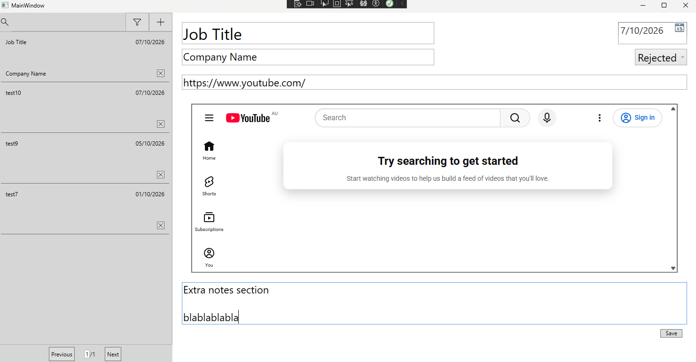

# Job Application Tracker

This is a dashboard for tracking, searching, and filtering job applications




The left hand panel contains the search results, with page navigation controls at the bottom. Up the
top of the left panel contains a search bar, filters for application status and date of application,
and the option to add more applications. You can delete applications by clicking the x on the bottom
right of each job in the left panel.

The right panel displays the job that is selected in the left panel. Entering a valid job link while
connected to the internet will fetch the text data from the website and store it in the database for
keyword searches. It will also embed the website on the right panel for reference. All job application
data can be edited in the right side panel and any changes will be saved to storage upon pressing the
save button in the bottom right of the page.

# Build Instructions

## Prerequisites

Windows (required for wpf gui)

.NET SDK 10.0.401 (as far as i know, may work with older versions)

Microsoft Edge WebView2 runtime (if not already installed)

### Building the application:

The application can be built by running the following from the repository root:

```
dotnet build JobApplicationTracker\JobApplicationTracker.csproj -c Release
```

Then you can launch it by just clicking on the .exe file typically generated in
JobApplicationTracker\bin\Release\net10.0-windows\JobApplicationTracker.exe

Alternatively you can launch the JobApplicationTracker.csproj file in Visual Studio, select the release configuration, and
build the JobApplicationTracker project.

### Running tests:

tests can be run by running the following from the repository root:

```
dotnet test JobApplicationTracker.slnx
```

Warning:

If you are going to run the tests but want to keep any applications you've created, make sure to move your
database file somewhere else temporarily. The tests create their own and will overwrite yours if
you leave it there.

Database file is created at %LOCALAPPDATA%\JobApplicationTracker\applications.db

